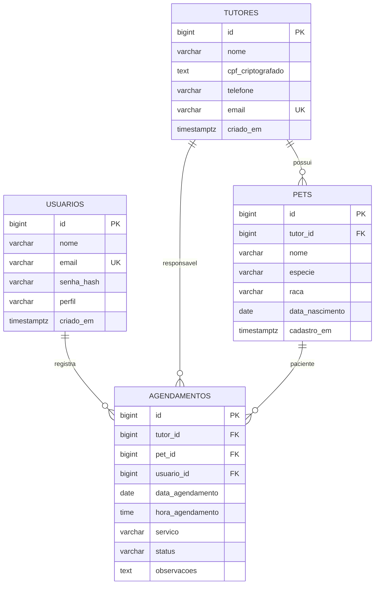

# Gerenciamento Super Pets — Sistema de Gestão de Clínica Veterinária

Aplicação MVC em PHP e PostgreSQL para autenticação de funcionários e gestão de tutores, pets e agendamentos.

## 1. Requisitos

- PHP 8.2 ou superior com `pdo_pgsql`, `openssl` e `session`.
- PostgreSQL 14 ou superior.
- Composer 2.

### 1.1 Requisitos Funcionais

| ID | Requisito |
| --- | --- |
| RF-01 | Encerrar a sessão pelo recurso de logout. |
| RF-02 | Exibir o nome do usuário autenticado, acesso às funcionalidades e opção de sair. |
| RF-03 | Cadastrar tutores, armazenando o CPF criptografado. |
| RF-04 | Pesquisar tutores por nome, e-mail ou telefone e atualizar a listagem com os resultados. |
| RF-05 | Editar os dados de um tutor e salvar as alterações. |
| RF-06 | Cadastrar pets vinculados obrigatoriamente a um tutor. |
| RF-07 | Listar os pets e seus tutores. |
| RF-08 | Cadastrar e listar agendamentos em ordem crescente de data e horário, exibindo os dados do tutor e do pet. |
| RF-09 | Alterar e salvar a data e, opcionalmente, o horário de um agendamento existente. |

### 1.2 Requisitos Não Funcionais

- Organização MVC e autoload PSR-4 (`App\\` aponta para `sistema/src/`).
- PostgreSQL acessado via PDO e consultas parametrizadas.
- Hash de senha via `password_hash` / `password_verify`.
- CPF cifrado com AES-256-GCM; uma impressão HMAC impede CPFs duplicados sem armazená-los em texto claro; dados legados AES-256-CBC continuam legíveis para migração.
- Proteção CSRF nos formulários e expiração da sessão por inatividade.
- As chaves de criptografia e credenciais do banco devem ser tratadas como configuração local, nunca publicadas em repositório ou documentação.

## 2. Modelo de dados (DER)



O vínculo composto entre pet e tutor em `agendamentos` impede associar um agendamento a um tutor diferente daquele cadastrado para o pet. Também há restrição para evitar dois agendamentos do mesmo pet no mesmo horário.


## 3. Instalação e execução local

Para começar, abra o PowerShell na pasta do sistema e instale as dependências:

```powershell
cd C:\Users\35T2\Documents\Lucas\saep\sistema
composer install
```

O sistema precisa do PHP 8.2 ou superior, com as extensões `pdo_pgsql`, `openssl` e `session`, além do PostgreSQL.

Configure a conexão com o banco em `config/database.ini`. Se o arquivo ainda não existir, crie uma cópia do modelo:

```powershell
Copy-Item config\database.example.ini config\database.ini
```

Preencha os dados do PostgreSQL e defina uma chave privada em `security.app_key`. Para gerar uma chave aleatória, use:

```powershell
php -r "echo bin2hex(random_bytes(32)), PHP_EOL;"
```

Guarde essa chave em segurança. Depois que houver CPFs cadastrados, não a troque sem planejar a migração dos dados cifrados.

Com o banco criado, abra o Query Tool no pgAdmin e execute `database/schema.sql`. Se quiser carregar alguns dados para testar, rode no PowerShell:

```powershell
php database\seed.php
```

O script inclui usuários, tutores, pets e agendamentos de demonstração. Os dados de acesso estão definidos nele; use essas contas apenas no ambiente local.

Para iniciar o sistema, ainda na pasta `sistema`, execute:

```powershell
php -S 127.0.0.1:8000 -t public public\router.php
```

Acesse <http://127.0.0.1:8000/login> no navegador e entre com uma conta cadastrada. Para parar o servidor, volte ao PowerShell e pressione `Ctrl+C`.

### 3.1 Acesso de demonstração (Senha)

Use estas credenciais somente no ambiente local:

**Senha:** `Teste-local-2026!`

## 4. Verificações

Para conferir a configuração do Composer e a sintaxe dos arquivos PHP:

```powershell
composer validate --no-check-publish
Get-ChildItem src,public,database -Recurse -Filter *.php | ForEach-Object { php -l $_.FullName }
```
